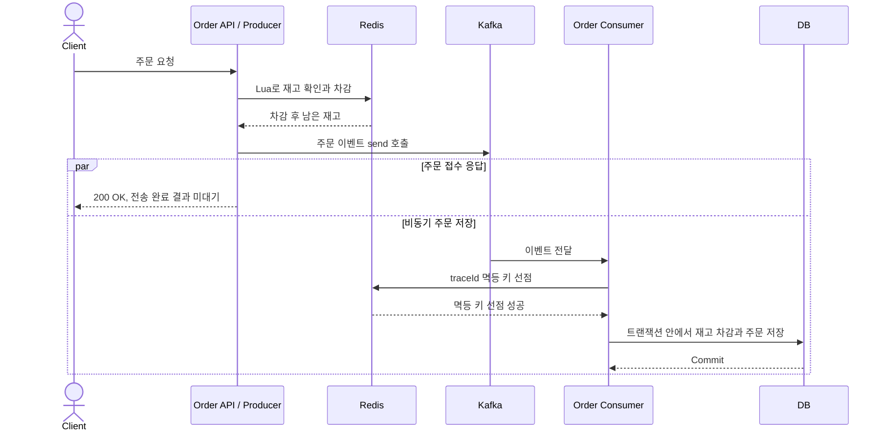
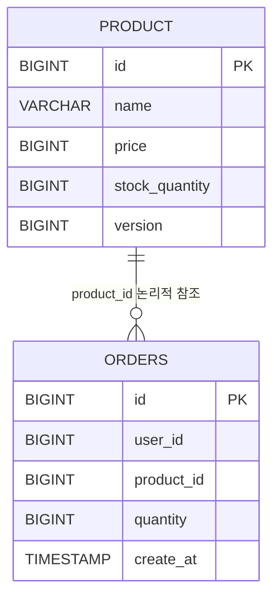

# Time Deal Service

> Redis Lua Script로 재고를 선점하고 Kafka로 주문 저장을 분리해, 주문이 몰릴 때 재고 정합성과 응답 시간을 함께 다루는 타임딜 백엔드


## 프로젝트 소개

한정 수량 상품에 주문이 몰릴 때, 재고를 초과해 주문을 받지 않으면서 요청마다 드는 처리 비용을 줄이는 방법을 확인해 본 개인 프로젝트입니다. 범위는 상품 재고와 주문 접수·저장까지로 한정했습니다. DB 비관적·낙관적 락과 Redisson 분산 락을 구현한 뒤, 재고 확인과 차감을 Lua Script 하나로 묶는 방식으로 옮겼습니다.

가장 신경 쓴 부분은 접수 응답과 저장 완료를 구분하는 것이었습니다. 응답이 빨라도 저장에 실패하면 재고와 주문이 어긋나기 때문에, 비동기 처리가 끝난 뒤 재고와 주문 수를 함께 확인하는 테스트를 작성했습니다.

- **재고 차감 방식 비교:** DB 락 2종, Redisson 분산 락, Lua Script를 구현해 대기·재시도 비용을 비교했습니다.
- **접수와 저장의 분리:** Redis에서 재고를 선점한 뒤 Kafka로 이벤트를 보내고, 바로 접수 응답을 반환합니다.
- **최종 상태 검증:** 분산 락 주문 경로에서 재고 10개에 작업 100개를 제출하고, DB·Redis 재고 0과 주문 10건을 확인하는 테스트를 작성했습니다.

## 기술 스택

| 구분 | 기술 | 사용 목적 |
| --- | --- | --- |
| 애플리케이션 | Java 17, Spring Boot 3.5 | 주문 접수 API와 요청 값 검증 |
| 데이터 | Spring Data JPA, H2 | 상품·주문 저장, DB 락 비교. H2는 별도 설치 없이 로컬에서 바로 실행하는 인메모리 DB |
| 재고·락 | Redis, Redisson, Lua Script | 재고 선점(Lua), 분산 락 비교(Redisson), 이벤트 중복 확인 키 저장 |
| 메시징 | Apache Kafka, Spring Kafka | 주문 이벤트 전달, 재시도·DLT 처리 |
| 관측 | MDC, Actuator, Micrometer, Prometheus, Grafana | `traceId`로 로그 연결, 요청률·지연·JVM 상태 확인 |
| 테스트·빌드 | JUnit 5, AssertJ, Awaitility, k6, Gradle, GitHub Actions | 동시성·비동기 결과 검증, 부하 테스트, 빌드와 CI |

## 아키텍처

### 처리 흐름



Lua 주문 경로의 정상 처리 흐름입니다. HTTP 응답과 Consumer 처리는 독립적으로 진행합니다.

Redis 재고는 새 주문을 받을 수 있는 수량이고, DB 재고는 저장된 주문을 반영한 수량입니다. 응답을 빠르게 하려고 DB 저장을 Consumer로 넘겼기 때문에, 비동기 처리 중에는 두 값이 잠시 다를 수 있습니다. 현재 `200 OK`는 주문 접수 응답이며, Kafka Broker의 저장 확인이나 DB 저장 완료까지 뜻하지는 않습니다.

## 주요 기능과 구현 포인트

### 재고 차감 방식 비교

같은 재고를 동시에 차감할 때 어떻게 막을지를 네 가지 방식으로 구현했습니다.

| 방식 | 구현 | 비교한 지점 |
| --- | --- | --- |
| DB 비관적 락 | `PESSIMISTIC_WRITE` | 같은 상품을 갱신하는 요청이 DB 락을 기다립니다. |
| DB 낙관적 락 | `@Version`, 충돌 시 50ms 대기 후 재시도 | 충돌이 많아지면 재시도 비용이 발생합니다. 현재 횟수 제한은 없습니다. |
| Redisson 분산 락 | 상품별 `RLock` | 락 획득·반납과 Redis 재고 연산에 통신과 대기가 필요합니다. |
| Redis Lua Script | 재고 조회와 조건부 차감을 원자적으로 실행 | 별도의 분산 락 획득·반납 없이 재고를 선점합니다. |

DB 락 방식은 서비스와 통합 테스트에서 비교했습니다. HTTP 주문 API는 분산 락과 Lua 두 경로를 제공하며, 둘 다 Redis 선점 후 Kafka로 주문 저장을 넘기므로 재고 선점 방식의 차이를 비교할 수 있습니다.

이 중 Lua Script를 주문 경로의 기본으로 선택했습니다. 락을 잡고 놓는 과정 없이 확인과 차감을 한 번에 처리할 수 있기 때문입니다. 부하 조건에서의 수치 비교는 같은 조건으로 다시 측정한 뒤 정리할 예정입니다.

구현: [ProductService](src/main/java/com/example/timedeal/domain/product/service/ProductService.java), [OptimisticLockFacade](src/main/java/com/example/timedeal/domain/product/service/OptimisticLockFacade.java), [RedissonLockFacade](src/main/java/com/example/timedeal/domain/product/service/RedissonLockFacade.java)

### Lua Script로 확인과 차감을 한 번에

재고를 조회한 뒤 따로 차감하면 두 작업 사이에 다른 요청이 끼어들 수 있습니다. Lua Script 안에서 조회와 조건부 차감을 원자적으로 실행해 이 틈을 없앴습니다.

```lua
local stock = redis.call('get', KEYS[1])
if not stock then return -1 end

if tonumber(stock) >= tonumber(ARGV[1]) then
    return redis.call('decrby', KEYS[1], ARGV[1])
else
    return -2
end
```

성공하면 남은 재고를 반환하고, 재고 키가 없거나 수량이 부족하면 주문을 거절합니다.

### 비동기 주문 처리와 중복 방어

Consumer는 Redis `setIfAbsent`로 `traceId` 기반 멱등 키를 선점하고, 키가 있으면 중복 이벤트로 판단해 건너뜁니다. 선점에 성공하면 DB 재고 차감과 주문 저장을 하나의 DB 트랜잭션으로 처리합니다.

재시도 대상 예외에는 2초 고정 백오프를 적용하고, 최초 처리를 포함해 총 3회 실패하면 DLT로 격리합니다.

현재 중복 방어는 Kafka 이벤트 재전달까지만 다루며, HTTP 재요청에는 별도의 요청 멱등 키가 필요합니다. 또 Redis 멱등 키 선점과 DB 저장은 원자적으로 묶여 있지 않아, DB 실패 뒤 재시도가 생략될 수 있습니다.

구현: [OrderEventProducer](src/main/java/com/example/timedeal/domain/order/producer/OrderEventProducer.java), [OrderEventConsumer](src/main/java/com/example/timedeal/domain/order/consumer/OrderEventConsumer.java)

### 요청 추적

요청마다 만든 `traceId`를 Kafka Header로 넘기고 Consumer의 MDC에 다시 넣어, 주문 접수부터 이벤트 처리까지 같은 ID로 로그를 따라갈 수 있게 했습니다.

## 실행 방법

JDK 17과 Docker Compose가 필요합니다. 저장소 루트에서 인프라를 시작하고 Kafka가 준비되면 애플리케이션을 실행합니다.

```bash
docker compose up -d
docker compose ps
```

```bash
./gradlew bootRun
```

상품이 없는 새 DB에서 첫 상품을 만들고 주문을 접수하는 예시입니다.

```bash
curl -X POST \
  "http://localhost:8080/api/v1/admin/products/prepare?productId=1&stockQuantity=100"

curl -X POST "http://localhost:8080/api/v1/orders/lua/1" \
  -H "Content-Type: application/json" \
  -d '{"userId":100,"quantity":1}'
```

준비 API는 기존 상품이 있으면 DB 재고를 변경하지 않고 Redis에 복사합니다. 신규 상품의 ID는 DB가 자동 생성하므로, 로그에서 실제 ID를 확인해 주문 URL에 사용합니다. 주문 처리 중에는 재고를 덮어쓰지 않도록 준비 API를 호출하지 않습니다.

## API

| 엔드포인트 | 설명 |
| --- | --- |
| `POST /api/v1/orders/lua/{productId}` | Lua 기반 주문 접수 |
| `POST /api/v1/orders/{productId}` | 분산 락 기반 주문 접수 |
| `POST /api/v1/admin/products/prepare` | 테스트 상품 생성·재고 동기화 |
| `GET /actuator/health` | 상태 확인 |
| `GET /actuator/prometheus` | 메트릭 조회 |

주문 요청의 `userId`는 필수이며 `quantity`는 1 이상이어야 합니다.

<details>
<summary>주문 응답 예시와 주요 오류</summary>

```json
{
  "timestamp": "2026-10-18T15:30:00.123",
  "traceId": "9d782d14-f73d-480c-b756-20e8d4fd8d12",
  "code": "SUCCESS",
  "message": "요청이 성공적으로 처리되었습니다",
  "data": "주문 요청이 성공적으로 접수되었습니다. (Lua Script)"
}
```

| 상황 | HTTP 상태·에러 코드 |
| --- | --- |
| DTO 검증 실패 | `400 COMMON_001` |
| 재고 부족 | `400 STOCK_001` |
| Lua API의 재고 키 없음 | `404 PRODUCT_001` |
| 분산 락 획득 실패 | `500 COMMON_500` |

테스트 준비 API는 공통 JSON 응답 대신 완료 문자열을 반환합니다.

</details>

<details>
<summary>로컬 도구 접속 정보</summary>

- H2 Console: `http://localhost:8080/h2-console`, JDBC `jdbc:h2:mem:testdb`, 사용자 `sa`, 비밀번호 공란
- Prometheus: `http://localhost:9090`
- Grafana: `http://localhost:3000`, 초기 계정 `admin/admin`, Prometheus 데이터 소스 `http://prometheus:9090`

H2 데이터는 애플리케이션 재시작 시 초기화되며 Redis와 Kafka 상태는 따로 남을 수 있습니다. 현재 설정은 인증과 접근 제한이 없는 로컬 실험용입니다. Prometheus의 호스트 연결 주소는 Docker Desktop의 `host.docker.internal`을 사용합니다.

</details>

## DB 설계



상품은 재고와 낙관적 락용 `version`을, 주문은 사용자·상품 ID, 수량과 생성 시각을 저장합니다. 두 엔티티는 상품 ID로 논리적으로만 연결했고, DB 외래 키나 JPA 연관관계는 선언하지 않았습니다. 엔티티는 [Product](src/main/java/com/example/timedeal/domain/product/entity/Product.java), [Order](src/main/java/com/example/timedeal/domain/order/entity/Order.java)에 있습니다.

Redis에는 세 종류의 키를 사용합니다.

| Redis 키 | 용도 |
| --- | --- |
| `product_stock:{productId}` | 주문 접수 단계의 가용 재고 |
| `product_lock:{productId}` | 분산 락 방식의 상품별 락 |
| `idempotency:order:{traceId}` | Consumer의 이벤트 중복 확인 |

## 테스트와 검증 범위

### 동시성·비동기 처리 테스트

[ProductServiceTest](src/test/java/com/example/timedeal/domain/product/service/ProductServiceTest.java)의 분산 락 주문 테스트는 재고 10개에 주문 작업 100개를 제출하고, Awaitility로 Consumer 처리가 끝나길 기다린 뒤 DB 재고 0·Redis 재고 0·주문 10건을 함께 확인합니다.

비관적·낙관적·분산 락의 재고 차감 테스트도 있습니다. Lua 주문 경로의 최종 상태 검증은 다음에 추가할 항목입니다.

```bash
docker compose up -d redis zookeeper kafka
./gradlew test --no-daemon
```

각 테스트가 끝날 때 `FLUSHDB`로 연결된 Redis 논리 DB 전체를 비웁니다. 현재 대상은 기본 DB 0이므로 다른 애플리케이션과 Redis를 공유하지 않는 전용 환경에서 실행해야 합니다.

[GitHub Actions](.github/workflows/ci.yml)는 `main`의 push와 pull request에서 Redis·Kafka 서비스 컨테이너를 실행하고 `./gradlew clean build`를 수행합니다.

### HTTP 부하 테스트

[k6 스크립트](scripts/k6/scenarios/final-stress-test.js)는 Lua 주문 API에 30초 동안 최대 100 VU까지 부하를 올렸다가 줄입니다. 성공 기준은 HTTP `200`, 즉 접수 응답이며 DB 저장 결과까지는 확인하지 않습니다. 품절 응답도 check 실패로 집계되므로, 이 결과만으로 주문 처리 성능을 판단하지는 않습니다.

<details>
<summary>부하 테스트 실행</summary>

k6를 설치한 뒤 위 실행 방법대로 애플리케이션을 시작합니다. 상품 ID `1`을 호출하므로 새 DB에서 충분한 재고로 첫 상품을 만들어 둡니다. 준비 API는 기존 상품의 DB 재고를 늘려 주지 않습니다.

```bash
curl -X POST \
  "http://localhost:8080/api/v1/admin/products/prepare?productId=1&stockQuantity=100000"

k6 run --summary-export=/tmp/time-deal-k6-summary.json \
  scripts/k6/scenarios/final-stress-test.js
```

</details>

## 시행착오와 배운 점

- **응답이 빨라진 뒤에는 최종 상태를 봐야 했습니다.** 접수 응답만으로는 주문이 저장됐는지 알 수 없어서, 테스트도 시간이 아니라 처리 완료 상태를 기다리도록 바꿨습니다. 처음에는 고정 10초를 기다렸지만, 지금은 Consumer 처리가 끝났는지를 조건으로 확인합니다. ([Awaitility 적용 커밋](https://github.com/alweiis/time-deal-service/commit/aa5824389215b9dfac4b2467f2bd93d9ea822b78))
- **멱등 키는 무엇을 키로 삼느냐에 따라 막는 범위가 달라집니다.** `traceId`를 써 보며 이 점을 확인했고, 이어지는 개선 과제로 정리했습니다.

## 향후 개선

- **주문 저장 실패 복구:** Redis 선점과 Kafka 발행·DB 저장은 하나의 트랜잭션으로 묶이지 않아, 발행이나 저장이 실패하면 재고와 주문이 어긋날 수 있습니다. 자동 복구는 다음 과제로 남겨 두었고, 이벤트 ID 기반 멱등 처리와 재처리·보상 흐름부터 보완할 계획입니다.
- **검증 범위 확대:** 지금까지는 단일 애플리케이션, 단일 Kafka Broker, H2 환경에서만 검증했습니다. Lua 주문 경로의 최종 상태 검증, 같은 조건의 부하 테스트 재측정, 다중 인스턴스 환경의 부하 테스트를 추가할 계획입니다.
